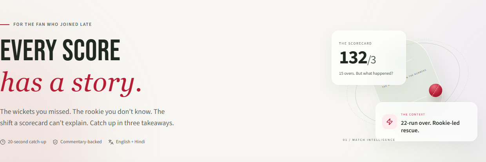
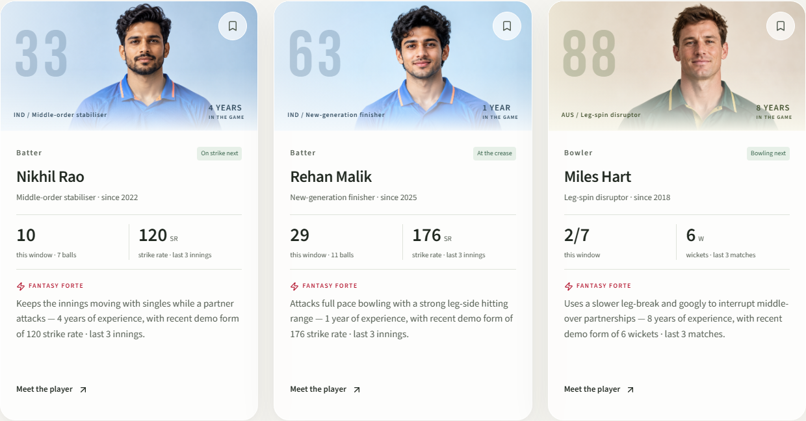

# Catch-Me-Up

**Every score has a story. Catch up on the one you missed.**

An AI-powered cricket companion for fans joining a match late. It turns the last five overs into three short, evidence-linked takeaways and introduces the players shaping the next over—in English or Hindi.

Built for the **Dream11 Forward Deployed Engineer Intern assignment**.



## The fan problem

A scorecard tells a late-arriving fan **132/3**. It doesn't explain whether a newcomer just rescued the chase, spin is choking the scoring, or an unfamiliar player has a useful strength against the next bowler. Catch-Me-Up adds that context without asking fans to read dozens of commentary entries or research an entire squad.

## Same score. Two stories.

Both fictional scenarios show **India at 132/3 after 15 overs, chasing 187**:

| Scenario | What a scorecard misses |
| --- | --- |
| **The comeback** (`ind-aus`) | A rookie-led 22-run over changes the chase after two wickets. |
| **The spin squeeze** (`spin-trap`) | A four-run final completed over exposes a chase losing rhythm against spin. |

Switch between them to see why the same score can mean very different things.

## Features

- **Three-point vibe check:** Gemini through LangChain explains the match context; each takeaway links to supporting deliveries.
- **Impact Players:** Two current batters and the bowler scheduled next, with experience, strengths, recent form, and Fantasy Forte.
- **English + Hindi:** Translates the interface, commentary, summaries, and player context; remembers the chosen language.
- **Explore the evidence:** Ball-by-ball commentary, spin-versus-pace context, and three- or five-over windows.
- **Interactive profiles:** Save a local shortlist, filter by role, and expand player background.
- **Responsive design:** Light glass surfaces, soft depth, player portraits, restrained motion, keyboard support, and reduced-motion support.
- **Recovery states:** Clearly handled loading, empty feeds, failed requests, and provider fallback.



## AI and data: what is real?

**Real AI inference:** With Gemini configured, AI is requested on initial load and when the match, over window, or language changes. **Catch me up** regenerates the analysis. Live Gemini generation has been verified locally in English and Hindi.

**Fictional source data:** Match snapshots, commentary, player names, career histories, and form records are intentionally fictional. Portraits are AI-generated fictional characters. This prototype does not fetch real live matches or support arbitrary match IDs.

**Transparent fallback:** Without credentials, or if generation fails, prepared summaries keep the demo usable. The interface exposes the generation mode and fallback notice. `mock` is not live AI inference.

Outputs use a Pydantic schema, validated player IDs, and validated commentary references. Reference validation does not prove every model sentence is correct; prose still needs review.

## Stack and architecture

| Layer | Tools |
| --- | --- |
| Frontend | React 19, TypeScript, Vite, Tailwind CSS, Framer Motion, Lucide |
| Backend | Python, FastAPI, Pydantic |
| AI | LangChain, Gemini; optional OpenAI integration |
| Verification | pytest, Playwright, axe-core |
| Deployment | Multi-stage Docker; FastAPI serves the compiled frontend and API |

```text
Fictional commentary + player profiles
                 ↓
FastAPI selects overs and computes statistics
                 ↓
LangChain → Gemini → structured story + Fantasy Forte
                 ↓
Schema / player / evidence-reference validation
                 ↓
React match story + three active-player cards
```

Overs use legal-ball counts, keeping extras in the correct over rather than blindly slicing 30 records. Recent form is calculated from the supplied appearances.

## Run locally

Prerequisites: **Node.js 22+**, **Python 3.12+**, and a Gemini API key for real generation. Commands below use Windows PowerShell.

```powershell
git clone https://github.com/asadullah098/Catch-me-up.git
cd Catch-me-up
npm.cmd ci
python -m venv .venv
.\.venv\Scripts\python.exe -m pip install -r backend/requirements.lock.txt
Copy-Item backend/.env.example backend/.env
```

Edit `backend/.env`:

```dotenv
LLM_PROVIDER=gemini
GEMINI_API_KEY=your_key_here
GEMINI_MODEL=gemini-3.5-flash-lite
LLM_TIMEOUT_SECONDS=12
```

That model was verified locally. If unavailable to your account, choose a supported model with `GEMINI_MODEL`. For a demo without external calls, set `LLM_PROVIDER=mock`.

Start the backend:

```powershell
.\.venv\Scripts\python.exe -m uvicorn backend.main:app --host 127.0.0.1 --port 8012
```

In a second terminal:

```powershell
npm.cmd run dev
```

Open **http://127.0.0.1:5180**. API docs: **http://127.0.0.1:8012/docs**. Restart the backend after changing provider settings. Keep keys server-side; environment files and local dependencies are excluded from Git.

## Verify real AI

With the backend running:

```powershell
$result = Invoke-RestMethod "http://127.0.0.1:8012/api/matches/ind-aus/catch-up?window=5&ai=true&language=en"
$result.mode
```

Expect `gemini` for successful inference. Repeat with `language=hi` for Hindi. A `mock` response means prepared demo output.

## Deploy

The Dockerfile builds the frontend and packages it with FastAPI, serving the application and `/api` from one origin on **port 8080**.

```powershell
docker build -t catch-me-up .
docker run --env-file backend/.env -p 8080:8080 catch-me-up
```

Open http://127.0.0.1:8080. Docker is unavailable in the development workspace, so the container build remains unverified.

For Render: create a **Web Service**, connect this repository, choose **Docker**, use `./Dockerfile`, and leave Docker Command blank. Configure:

| Environment variable | Value |
| --- | --- |
| `LLM_PROVIDER` | `gemini` |
| `GEMINI_API_KEY` | Your private API key |
| `GEMINI_MODEL` | The model verified for your account |
| `LLM_TIMEOUT_SECONDS` | `12` |
| `PORT` | `8080` |

Use `/api/health` as the health check path. This configuration needs no separate frontend deployment or `VITE_API_BASE`. Verify the public URL on another device and repeat the provider checks. Public hosting remains pending; localhost is not the submission artifact link.

## Verification

```powershell
npm.cmd run build
.\.venv\Scripts\python.exe -m pytest backend/test_api.py -q
npx.cmd playwright install chromium
# With both local development servers running:
npm.cmd run test:ui
node scripts/verify-artwork.mjs
```

Latest checks: production build passed; 14 backend tests passed; bilingual UI checks passed. Artwork checks cover seven widths from 320 to 1440px, portrait loading, and four accessibility scans. Automated browser checks substitute deterministic responses for provider calls, avoiding API quota use. Verification output is stored in ignored `artifacts/`.

## One-minute evaluator walkthrough

1. Show **132/3** and read the rookie-led comeback.
2. Open a takeaway's supporting deliveries.
3. Switch to **The spin squeeze** while the score stays unchanged.
4. Open Rehan Malik's background and Fantasy Forte.
5. Switch to **Hindi**, then regenerate with **Catch me up**.

## Project guide

| Path | Purpose |
| --- | --- |
| `src/` | Bilingual React interface and local portraits |
| `backend/main.py` | Context, API, AI generation, validation, and fallback |
| `data/` | Fictional commentary snapshots and player profiles |
| `design-system/MASTER.md` | UI/UX Pro Max design system and spatial glass styling |
| `src/assets/players/README.md` | Portrait provenance and prompt set |
| `project_context.md` | Product goals and scope |
| `implementation_plan.md` | Implementation sequence |
| `progress_tracking.md` | Completed work and remaining dependencies |
| `submission_readiness.md` | Assignment readiness checklist |
| `submission_note.md` | Submission note under 200 words |

## Next steps

Publish the artifact and verify hosted AI generation. Beyond this assignment prototype: reliable live commentary, verified player records, freshness handling, rate limits, provider cost controls, and grounding evaluation.

AI tools used: **Gemini through LangChain** for summaries, **Codex** for implementation and UI iteration, and built-in **image generation** for fictional portraits. This is an independent internship prototype, not an official Dream11 product.
